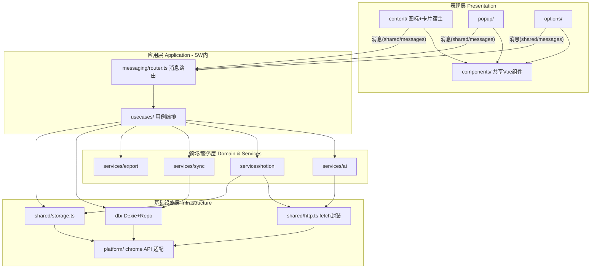
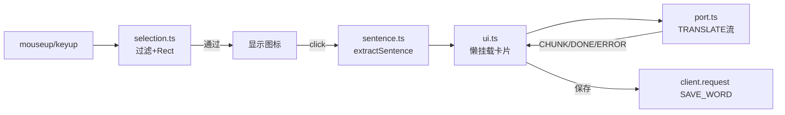
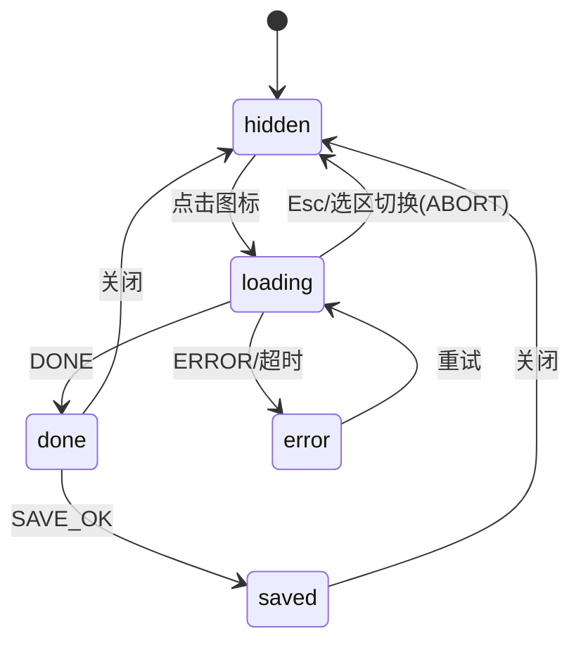
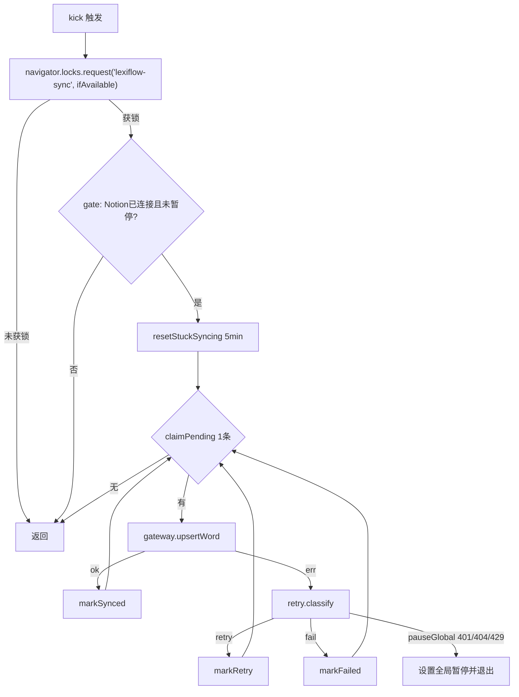
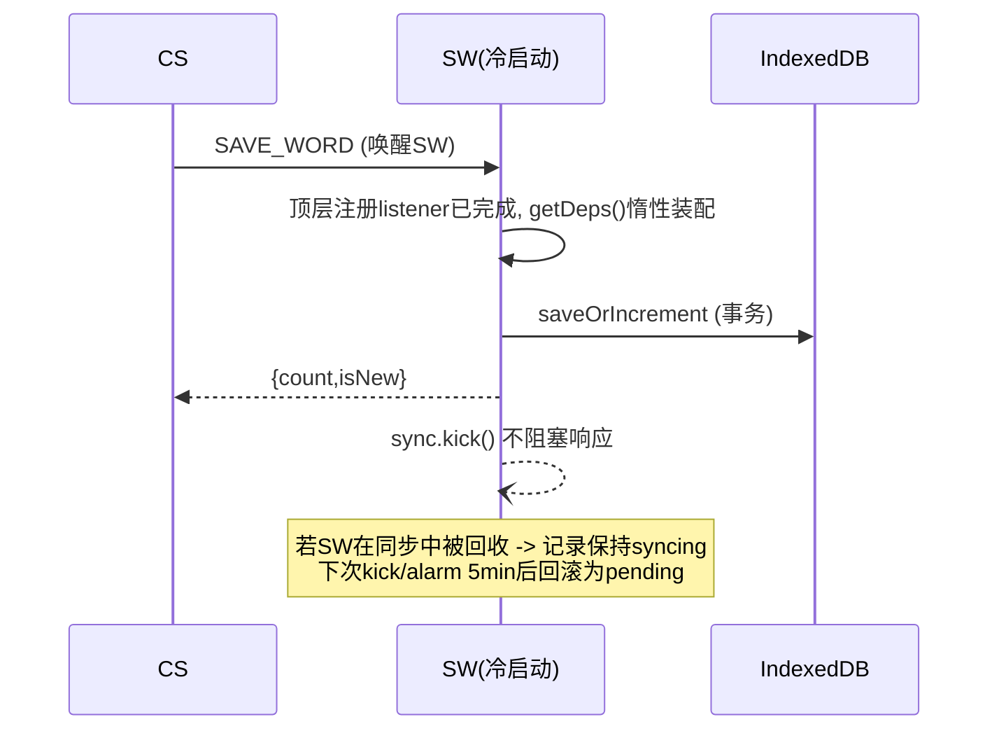
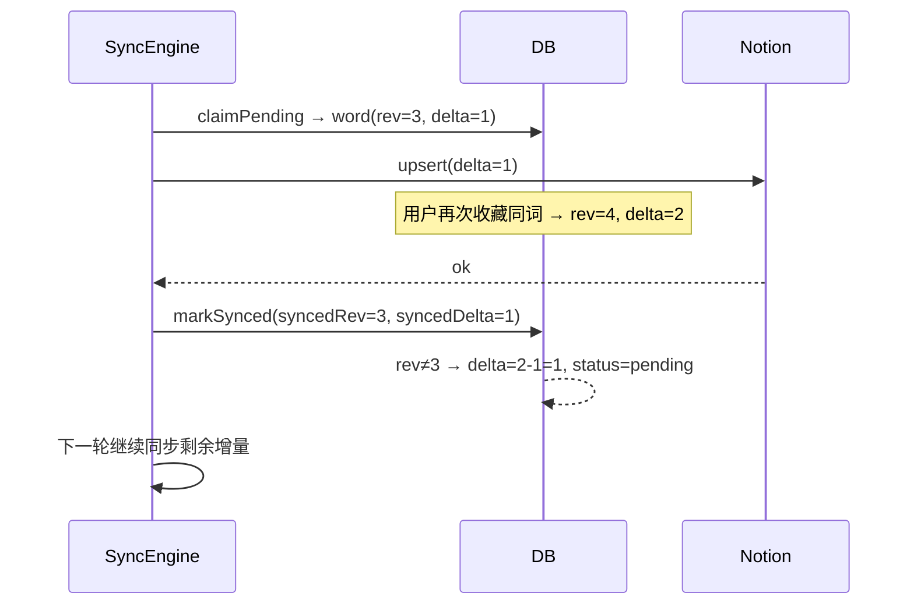

# LexiFlow AI 项目详细架构文档

> 配套 [PRD.md](./PRD.md)。本文描述"怎么实现"：运行时划分、分层、模块接口、关键机制、构建与测试约定。

## 1. 架构总览

### 1.1 设计目标与原则
| 原则 | 落地方式 |
|---|---|
| KISS | 无后端、无状态管理库（用 Vue `ref` + Dexie `liveQuery`）、无 DI 框架（手写工厂函数） |
| 凭证隔离 | `services/` 目录仅 SW 与 Options 可引用，ESLint 强制 |
| SW 无状态 | SW 随时被回收；所有状态落在 IndexedDB / `storage.local`；内存仅作缓存 |
| 本地优先 | 写库 → 响应 UI → 异步同步，同步失败不影响采集 |
| 单一数据流 | UI 不直接调网络；一律经"消息 → SW → 服务层" |
| 可测试 | 纯逻辑（句子提取、解析、映射、退避）与 Chrome API 解耦，Vitest 可直接测 |

### 1.2 运行时上下文

| 上下文 | 入口 | 生命周期 | 可访问 | 禁止 |
|---|---|---|---|---|
| Content Script (isolated world) | `entrypoints/content` | 随页面 | DOM、`runtime.sendMessage/connect` | 读 storage 凭证、直接发 AI/Notion 请求、引用 `services/` |
| Service Worker | `entrypoints/background.ts` | 事件驱动，空闲 ~30s 回收 | 全部 API、网络、Dexie、storage | 依赖内存状态、使用 DOM/`window`/`localStorage` |
| Popup | `entrypoints/popup` | 打开期间 | Dexie（只读为主）、消息 | 直接调用 AI/Notion |
| Options | `entrypoints/options` | 标签页期间 | storage 读写（配置）、Dexie（导出）、消息 | — |

> Dexie 实例在 SW/Popup/Options 各自打开，IndexedDB 同源共享；**写操作只在 SW 执行**（单写者），Popup/Options 只读并通过 `liveQuery` 订阅变更，避免并发写冲突。导出属于只读。

### 1.3 分层架构



**依赖方向**：上层依赖下层；`shared/` 可被所有层引用但不得引用上层；`services/*` 之间仅允许 `sync → notion/mapper`、`usecases → services`，禁止循环。

### 1.4 目录职责补充（在 PRD 5.1 基础上细化）

```
entrypoints/
  background.ts            # 仅做装配: 注册 listener → 委托 router/alarms
  content/                 # index.ts 装配; selection.ts; sentence.ts; ui.ts(挂载); port.ts(与SW通信)
  popup/ options/          # 各自 main.ts + App.vue + composables/
usecases/                  # SW 内的用例(一个文件一个动作)
  translate.ts  saveWord.ts  syncNow.ts  connectNotion.ts  disconnectNotion.ts
  testAi.ts  setSiteDisabled.ts  getWordState.ts
messaging/
  router.ts                # type → handler 映射 + sender 校验
  client.ts                # UI 侧封装: request()/openStream()
  types.ts                 # 由 shared/messages 再导出(可选)
services/ ...              # 见 PRD
db/ ...
platform/
  chrome.ts                # storage/identity/alarms/permissions 的薄封装, 便于测试 mock
shared/ ...
```

## 2. 核心模块设计

### 2.1 消息层（Messaging）

**类型安全协议**（`shared/messages.ts`）：用映射类型一次声明请求/响应。

```ts
export interface RpcMap {
  SAVE_WORD:        { req: { entry: AiWordEntry; context: WordContextInput }; res: { count: number; isNew: boolean } };
  GET_WORD_STATE:   { req: { lemma: string };            res: { exists: boolean; count: number } };
  SYNC_RETRY:       { req: { id?: number };              res: { queued: number } };
  GET_SITE_DISABLED:{ req: { host: string };             res: { disabled: boolean } };
  SET_SITE_DISABLED:{ req: { host: string; disabled: boolean }; res: void };
  TEST_AI:          { req: AiConfigInput;                res: { ok: boolean; ms: number; error?: string } };
  CONNECT_NOTION:   { req: void;                         res: NotionConnectResult };
  DISCONNECT_NOTION:{ req: void;                         res: void };
  GET_STATUS:       { req: void;                         res: AppStatus }; // ai/notion/队列概况(不含凭证)
}
export type RpcType = keyof RpcMap;

// 流式通道(port 名称: 'translate')
export type StreamC2S = { type: 'TRANSLATE'; requestId: string; payload: TranslateRequest } | { type: 'ABORT'; requestId: string };
export type StreamS2C =
  | { type: 'CHUNK'; requestId: string; text: string }
  | { type: 'DONE';  requestId: string; entry: AiWordEntry }
  | { type: 'ERROR'; requestId: string; error: AppError };
```

**Router**（SW）：
```ts
const handlers: { [K in RpcType]: (req: RpcMap[K]['req'], sender: Sender) => Promise<RpcMap[K]['res']> } = { ... };
chrome.runtime.onMessage.addListener((msg, sender, sendResponse) => {
  if (sender.id !== chrome.runtime.id) return;        // 来源校验
  if (!isRpcType(msg?.type)) return;
  handlers[msg.type](msg.payload, sender)
    .then(data => sendResponse({ ok: true, data }))
    .catch(e => sendResponse({ ok: false, error: toAppError(e) }));
  return true;                                        // 异步响应
});
```
- **来源权限矩阵**：CS 仅允许 `SAVE_WORD / GET_WORD_STATE / GET_SITE_DISABLED` 与 `translate` port；`TEST_AI / CONNECT_NOTION / DISCONNECT_NOTION / SYNC_RETRY / SET_SITE_DISABLED` 仅允许扩展页（通过 `sender.url` 以 `chrome-extension://<id>/` 开头判断；`sender.tab` 存在且 url 非扩展页即为 CS）。
- **错误模型**：统一 `AppError { code: ErrorCode; message: string; retryable: boolean; detail?: unknown }`，`ErrorCode` 枚举见 §4.1。
- **流式 port 保活**：流式期间 port 连接保持 SW 存活；长于 30s 的无事件间隔由上游 SSE chunk 重置计时。CS 在 `onDisconnect` 时若未 DONE 则重连并重发一次。

### 2.2 Content Script



- **装配**：`defineContentScript({ matches:['<all_urls>'], cssInjectionMode:'ui', main(ctx) {...} })`；`ctx.onInvalidated()` 中移除 UI/监听，处理扩展重载。
- **启动流程**：`main` → `GET_SITE_DISABLED(host)`；已禁用则不注册监听。订阅 `storage.onChanged` 的 `disabledHosts` 实时启停（CS 无权读 storage 时，改由 SW 广播 `runtime.sendMessage → tabs` 或由 Popup 切换后 `tabs.sendMessage({type:'SITE_TOGGLED'})`，采用后者，KISS）。
- **UI 挂载**：图标与卡片使用同一个 `createShadowRootUi`（`position:'inline'`, `anchor:'body'`, `mode:'closed'`）；卡片组件 `defineAsyncComponent` 懒加载，首次点击才加载。
- **卡片状态机**：

- **`extractSentence` 纯函数签名**：`(blockText: string, start: number, end: number, opts?) => { sentence: string; word: string }`，DOM 部分仅负责取 `blockText` 与偏移（`Range` → 在块内的字符偏移，用 `TreeWalker` 累计文本节点长度），便于单测。

### 2.3 AI 服务（`services/ai`）

| 文件 | 职责 | 关键签名 |
|---|---|---|
| `client.ts` | 构造请求、发起流、SSE 解析 | `streamChat(cfg, messages, {signal, onDelta}): Promise<string>` |
| `prompt.ts` | Prompt 组装 | `buildMessages(req: TranslateRequest, cfg): ChatMessage[]` |
| `parse.ts` | 宽容 JSON 解析、schema 校验 | `partialParse(text): Partial<AiWordEntry>`；`finalizeEntry(text): AiWordEntry`（失败抛 `AI_PARSE_ERROR`） |
| `normalize.ts` | baseUrl 规范化、lemma 归一 | `normalizeBaseUrl(url)`；`normalizeLemma(s)` |

**流式处理**：
```
fetch(stream) → ReadableStream → TextDecoder → 按 "\n" 缓冲 → 取 "data: " 行
  → "[DONE]" 终止 → JSON.parse(delta.content) 累加 → onDelta(acc)
```
SW 每收到一次 delta：`port.postMessage(CHUNK{text: acc})`（累计文本，CS 端可直接 `partialParse`，无需顺序依赖）。按 50ms 节流以减少消息量。

**降级链**：`json_object` 不支持（400 且 message 含 response_format）→ 去掉参数重试一次，并缓存该 `baseUrl+model` 为"不支持"（内存）。

### 2.4 Notion 服务（`services/notion`）

| 文件 | 职责 |
|---|---|
| `http.ts`（内部）/`api.ts` | 统一 `notionFetch(path, init)`：注入 `Authorization`、`Notion-Version: 2022-06-28`；全局令牌桶限速（≥350ms 间隔，`navigator.locks` 外部保证串行）；响应错误映射为 `AppError`（含 `Retry-After`） |
| `oauth.ts` | `connect(): Promise<NotionAuth>`：state 生成/校验、`launchWebAuthFlow`、token 交换 |
| `database.ts` | `findDatabase()`, `ensureSchema(dbId)`, `createDatabase(parentPageId)`, `pickParentPage()`, `ensureBinding()`（上述流程编排，幂等） |
| `mapper.ts` | `toProperties(word, mode)`, `toContextBlocks(contexts)`；纯函数，含截断（2000 字符）与分批（100 block） |
| `pages.ts` | `findPageByLemma(dbId, lemma)`, `createPage`, `updatePage`, `appendBlocks`, `listRecentChildren` |

**NotionClient 抽象**：`sync/queue` 仅依赖接口 `NotionGateway { upsertWord(word): Promise<UpsertResult> }`，实现位于 `notion/gateway.ts`，使队列可用假实现单测。

```ts
interface NotionGateway {
  upsertWord(w: Word): Promise<{ pageId: string; syncedDelta: number; syncedContextIds: string[] }>;
}
```

### 2.5 数据层（`db/`）

- `db/index.ts`：Dexie 实例单例，`version(1)` 如 PRD §3.1；导出 `db`。
- `db/wordRepo.ts`（只暴露意图方法，不外泄 Dexie 表）：
```ts
saveOrIncrement(entry, ctx): Promise<{ count: number; isNew: boolean }>   // 单事务，SW 内调用
claimPending(limit, now): Promise<Word[]>             // 原子地将 pending→syncing(需 nextRetryAt<=now)
markSynced(id, rev, result): Promise<void>            // 按 rev 扣减增量
markRetry(id, err, nextRetryAt): Promise<void>
markFailed(id, err): Promise<void>
resetStuckSyncing(olderThanMs): Promise<number>
resetFailed(id?): Promise<number>                     // 手动重试
recent(limit): Promise<Word[]>  /  watchRecent(limit): Observable<Word[]>
stats(): Promise<{ pending; failed; synced }>
exportAll(): Promise<Word[]>
```
- **并发写保证**：所有写入在 SW 内，`saveOrIncrement` 与 `markSynced` 使用 `db.transaction('rw', db.words, ...)`；`markSynced` 通过 `rev` 比对避免覆盖同步期间产生的新增量：
```
if (word.rev === syncedRev) { delta=0; contexts=[]; status='synced' }
else { delta -= syncedDelta; contexts -= syncedContextIds; status='pending' }
```
- **迁移**：每次变更 schema 新增 `version(n)`，保留旧版本声明；`upgrade()` 中做字段补全；导出 JSON 带 `schemaVersion`。

### 2.6 同步引擎（`services/sync`）



- **串行**：一次只处理一条（个人使用，吞吐足够，且天然遵守 Notion 限速）。
- **触发源**：`SAVE_WORD` 后 `kick()`、`alarms('sync')`、`runtime.onStartup/onInstalled`、`SYNC_RETRY`、`CONNECT_NOTION` 成功后。
- **全局暂停**：`pausedUntil`（429）与 `notionStatus != connected`（401/404）存于 `storage.local`，`gate()` 读取。
- **`retry.ts`（纯函数）**：
```ts
classify(err: AppError, retryCount: number): 
  | { kind: 'retry'; delayMs: number }
  | { kind: 'fail' }
  | { kind: 'pause'; until?: number; status?: NotionStatus }
backoff(retryCount) = min(30_000 * 2 ** retryCount, 1_800_000) * (0.8 + Math.random() * 0.4)
```
- **SW 被回收的容错**：`claimPending` 把记录置为 `syncing` 并写 `claimedAt`；SW 启动/每次 kick 执行 `resetStuckSyncing(5min)`。

### 2.7 用例层（`usecases/`）

每个用例为 `async function(deps)(input)`，`deps` 由 `background.ts` 一次装配注入（便于测试替换）：

```ts
interface Deps { db: WordRepo; storage: TypedStorage; ai: AiService; notion: NotionService; sync: SyncEngine; clock: () => number }
```
| 用例 | 步骤 |
|---|---|
| `translate` | 读 aiConfig → 校验 → 缓存命中检查 → `ai.stream` → 校验 → 回调 CHUNK/DONE |
| `saveWord` | `db.saveOrIncrement` → `sync.kick()`（不 await）→ 返回 |
| `connectNotion` | `oauth.connect` → `database.ensureBinding` → 保存状态 → `sync.kick()` |
| `disconnectNotion` | 清 `notionAuth/notionBinding`，状态置 `disconnected`，保留本地词库 |
| `testAi` | 最小请求 `max_tokens:5` 计时 |

### 2.8 配置与存储封装（`shared/storage.ts`）

```ts
const storage = {
  get<K extends keyof StorageSchema>(k: K): Promise<StorageSchema[K] | undefined>,
  set<K extends keyof StorageSchema>(k: K, v: StorageSchema[K]): Promise<void>,
  watch<K extends keyof StorageSchema>(k: K, cb: (v) => void): () => void,
};
```
- 敏感 key 清单 `SECRET_KEYS = ['aiConfig','notionApp','notionAuth']`；`GET_STATUS` 等对外 DTO 通过 `toPublicStatus()` 过滤。
- `redact(obj)`：日志输出前遮蔽 `apiKey/accessToken/clientSecret/authorization`。

### 2.9 UI 层约定（Vue）

- **组件**：`TranslateCard.vue` 为纯展示组件（props：`state`, `partial`, `entry`, `savedCount`, `error`；emits：`save`, `retry`, `close`, `copy`），CS 与 Popup 共用；通信逻辑放 composable：`useTranslate()`（封装 port 流 + `partialParse`）、`useRecentWords()`（`liveQuery` → `useObservable`）、`useStatus()`。
- **样式**：Tailwind；CS 内样式经 `?inline` 或 WXT `cssInjectionMode:'ui'` 注入 shadow；Options/Popup 正常引入。
- **状态管理**：不引入 Pinia；跨组件状态用 composable + `provide/inject`。
- **i18n**：v1 界面文案中文硬编码于 `shared/strings.ts`，预留抽取空间。

## 3. 关键横切机制

### 3.1 SW 生命周期与事件注册
- 所有 `chrome.*.addListener` **必须在 SW 顶层同步注册**（MV3 要求），`background.ts` 只做注册；异步初始化放在 handler 内惰性执行（`getDeps()` memoized）。
- 启动序列：`onInstalled`（创建 alarm、`storage.setAccessLevel('TRUSTED_CONTEXTS')`、`navigator.storage.persist()`）→ `onStartup`（`resetStuckSyncing` + `kick`）。
- alarm：`chrome.alarms.get('sync')` 不存在才创建，防止重复。

### 3.2 错误码（`shared/errors.ts`）
```ts
type ErrorCode =
 | 'AI_NOT_CONFIGURED' | 'AI_AUTH' | 'AI_NOT_FOUND' | 'AI_RATE_LIMIT' | 'AI_TIMEOUT' | 'AI_NETWORK' | 'AI_PARSE_ERROR' | 'AI_ABORTED'
 | 'NOTION_NOT_CONNECTED' | 'NOTION_AUTH' | 'NOTION_NOT_FOUND' | 'NOTION_RATE_LIMIT' | 'NOTION_VALIDATION' | 'NOTION_CONFLICT' | 'NOTION_SERVER' | 'NOTION_NETWORK'
 | 'OAUTH_CANCELLED' | 'OAUTH_NO_PARENT_PAGE' | 'OAUTH_STATE_MISMATCH'
 | 'DB_ERROR' | 'PERMISSION_DENIED' | 'UNKNOWN';
```
每个 code 对应：用户可读中文文案（`shared/strings.ts`）、`retryable` 默认值。

### 3.3 日志
`shared/log.ts`：`log.debug/info/warn/error(scope, msg, data?)`；开发模式输出，生产仅 `warn/error`；统一 `redact`。环形缓冲（内存 200 条）可在 Options"诊断"页复制，便于个人排障（v1.1）。

### 3.4 构建与配置（WXT）

```ts
// wxt.config.ts
export default defineConfig({
  modules: ['@wxt-dev/module-vue'],
  vite: () => ({ plugins: [tailwindcss()] }),
  manifest: {
    key: '<固定公钥, 不含私钥>',
    name: 'LexiFlow AI',
    permissions: ['storage', 'alarms', 'identity', 'activeTab'],
    host_permissions: ['https://api.notion.com/*'],
    optional_host_permissions: ['https://*/*', 'http://localhost/*', 'http://127.0.0.1/*'],
    action: { default_title: 'LexiFlow' },
  },
});
```
- **别名**：`@/` → 项目根；
- **ESLint 边界规则**：`entrypoints/content/**` 禁止 import `services/**`、`db/**`、`usecases/**`、`platform/**`；`entrypoints/popup/**` 禁止 import `services/ai|notion`。
- **环境变量**：不存放任何密钥；`.env` 仅允许非敏感开关（如 `VITE_DEBUG`）。`.gitignore` 包含 `.output/`、`.wxt/`、`*.pem`。
- **脚本**：`dev`（`wxt`）、`build`、`zip`（仅自用打包）、`typecheck`（`vue-tsc --noEmit`）、`lint`、`test`（Vitest）。
- **依赖清单**：`wxt`、`@wxt-dev/module-vue`、`vue`、`dexie`、`tailwindcss`、`nanoid`、`zod`（输出校验）；dev：`typescript`、`vue-tsc`、`vitest`、`fake-indexeddb`、`eslint`+`eslint-plugin-vue`。`liveQuery` 到 Vue 的桥接用 `dexie` 自带 `liveQuery` + 小型 `useObservable`（或 `@vueuse/rxjs` 不引入，手写 20 行）。

### 3.5 测试策略
| 层 | 工具 | 用例 |
|---|---|---|
| 纯函数 | Vitest | `extractSentence`（缩写/小数/超长/中英混排）、`partialParse`/`finalizeEntry`（半截 JSON、代码块包裹、缺字段）、`mapper`（超长截断、block 分批）、`retry.classify/backoff`、`normalizeBaseUrl`、CSV 转义与公式注入 |
| 数据层 | Vitest + `fake-indexeddb` | `saveOrIncrement` 同句不累加/异句累加；`markSynced` rev 冲突；`claimPending` 原子性；`resetStuckSyncing` |
| 同步引擎 | Vitest + 假 `NotionGateway` | 成功/重试/failed/全局暂停；并发 kick 只有一个执行（模拟 locks） |
| Notion/AI 客户端 | Vitest + `fetch` mock（`msw` 可选） | 状态码映射、`Retry-After`、SSE 半包 |
| 端到端 | 手工回归清单（见 §5） | 真实站点与真实 Notion 工作区 |

> Chrome API 通过 `platform/chrome.ts` 注入，测试用内存实现替换；WXT 提供 `fakeBrowser`（`wxt/testing`）亦可使用。

## 4. 时序补充

### 4.1 SW 冷启动处理一次保存


### 4.2 同步中产生新增量（rev 机制）


## 5. 质量保障与发布（自用）

**手工回归清单**
1. 普通文章、GitHub README、SPA（如 YouTube 评论）、含 iframe 页面划词；输入框不触发。
2. 严格 CSP 站点卡片渲染正常；宿主页面样式无污染。
3. 错误 Key / 错误 URL / 429 / 超时：提示正确。
4. 全新 Notion 工作区授权建库；二次授权不重复建库；删库后重绑。
5. 断网收藏 → 联网后自动同步；同步中再次收藏同词无增量丢失。
6. 导出 JSON/CSV 在 Excel/VS Code 中中文正常；公式注入前缀生效。

**发布**：自用加载 `.output/chrome-mv3`（开发者模式）；`wxt zip` 备份；版本号遵循 semver，Dexie `schemaVersion` 随 DB 版本递增。

## 6. 扩展点与演进（非 v1 范围）
| 方向 | 预留 |
|---|---|
| 多 AI 提供商 | `AiService` 接口化；`prompt/parse` 与协议解耦 |
| Notion API 升级到 data source | 仅改 `notion/api.ts`、`database.ts`、`mapper.ts`，`NotionGateway` 不变 |
| 复习/发音 | 新增 `usecases/` 与 Popup 页签，不改同步链路 |
| 导入 | `services/export.ts` 增加 `importJson`，按 lemma 合并走 `saveOrIncrement` 逻辑 |
