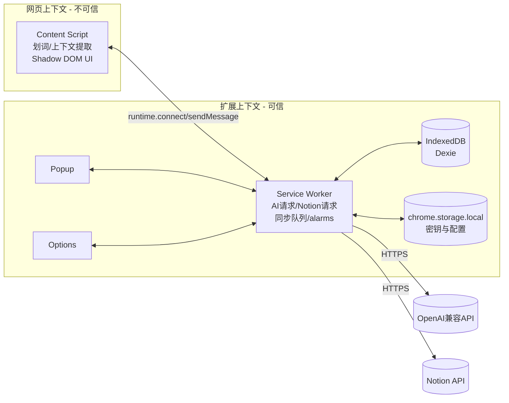
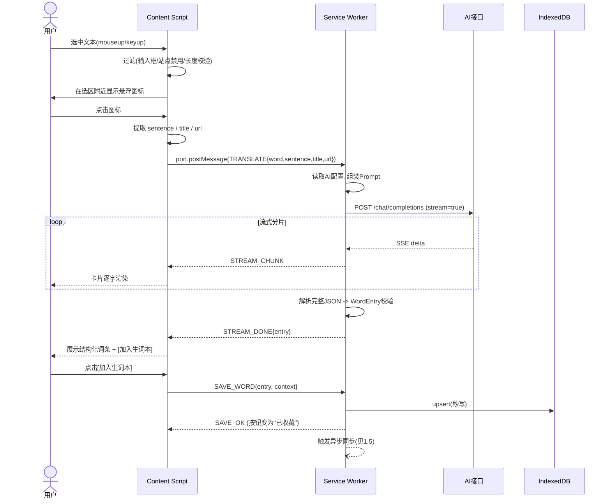
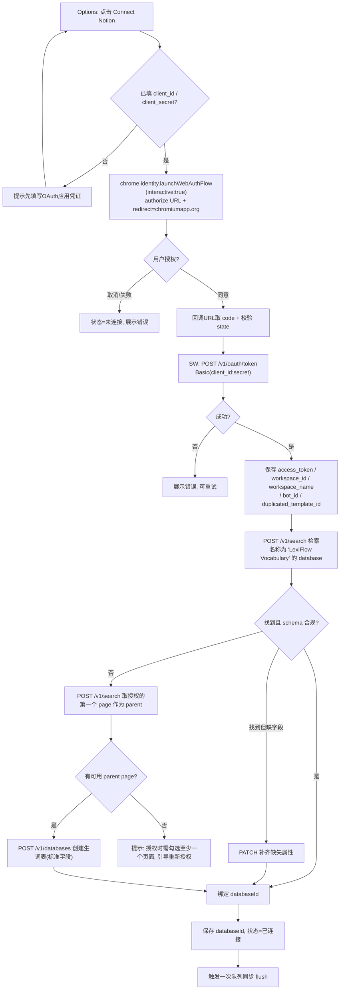
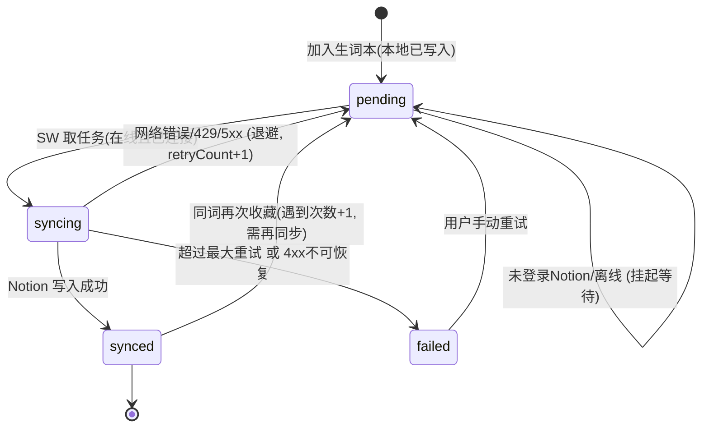
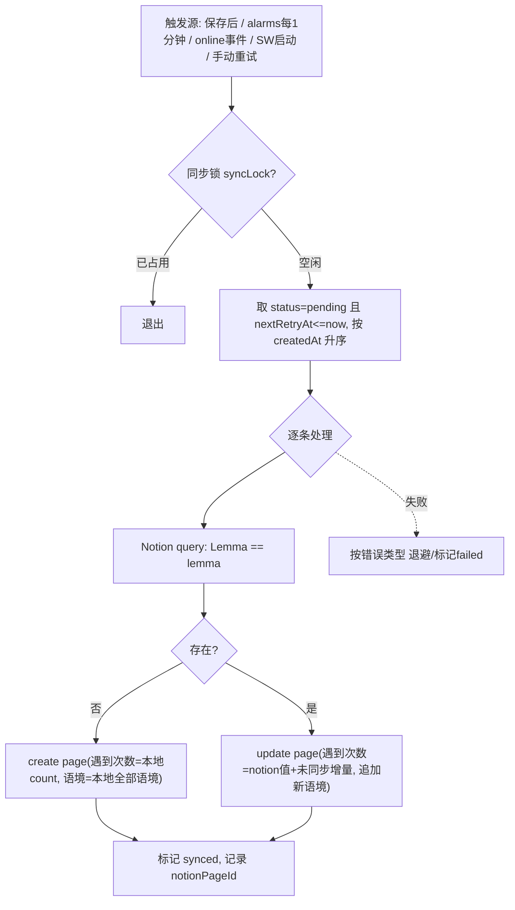

# LexiFlow AI（个人自用版）产品需求文档 PRD

| 项 | 内容 |
|---|---|
| 版本 | v1.0 |
| 日期 | 2026-11-06 |
| 形态 | Chrome 扩展（Manifest V3） |
| 技术栈 | WXT + Vue 3 + TypeScript + TailwindCSS + Dexie.js (IndexedDB) |
| 约束 | 零后端；仅个人使用；KISS |

---

## 1. 产品综述与核心业务流图

### 1.1 定位与原则
- **定位**：开发者个人日常阅读的划词翻译 + 生词采集工具。
- **重采集、轻后台**：本扩展只负责"采集 + 语境释义 + 同步"。复习、统计、打标签等一律交给 Notion（无头生词本）。
- **零后端**：所有网络请求由 Service Worker（SW）直连 AI 接口与 Notion API，无中转。
- **本地优先**：写入顺序固定为 IndexedDB → UI 反馈 → 异步同步 Notion。
- **KISS 取舍**：
  - 不做账号体系、不做密码学加密、不做多设备同步（Notion 即云端）。
  - 仅支持 Chrome/Chromium（依赖 `chrome.identity`）。

### 1.2 模块职责与信任边界



**边界规则**：API Key / Notion Token / Client Secret 只存在于 `chrome.storage.local`，且只有 SW 与 Options 页读取；Content Script 的消息协议中**永不返回**这些字段，也不能请求读取。

### 1.3 划词翻译流



### 1.4 Notion OAuth 自动建库流



### 1.5 离线缓冲同步流





---

## 2. 功能需求明细

### 2.1 模块一：网页划词与上下文捕获（Content Script）

| 项 | 说明 |
|---|---|
| 注入范围 | `matches: <all_urls>`，`run_at: document_idle`，仅 top frame（`allFrames:false`，v1 不处理 iframe） |
| 触发 | `mouseup` / `keyup(Shift+方向键)` 后延迟 ~50ms 读取 `window.getSelection()` |

**输入**：用户选区 `Selection`。

**过滤规则（任一命中则不显示图标）**：
1. 选区起止节点位于 `<input>`、`<textarea>`、`contenteditable` 内。
2. 选区为空或仅空白。
3. 选区长度 > 200 字符（视为段落，不触发单词模式）或不含任何字母/CJK 字符。
4. 当前 hostname 在禁用列表中。
5. 事件源在扩展自身 Shadow Host 内（避免点击卡片再次触发）。

**处理逻辑**：
1. **悬浮图标**：定位于选区 `getBoundingClientRect()` 末端偏下 8px，边界溢出时翻转；点击外部、滚动超阈值、选区清空后 150ms 内消失。
2. **上下文原句提取**（`extractSentence(range)`）：
   - 取选区所在最近块级祖先（`p, li, div, td, h1-h6, blockquote`）的 `textContent`，定位选区在其中的偏移。
   - 以句末标点 `.!?。！？;；` 与换行向左右扩展到句界；规避缩写（`e.g. Mr. Dr. etc. U.S.` 白名单）和小数点。
   - 句子长度上限 400 字符：超限则以选词为中心截取 ±200 字符并在边界补 `…`。
   - 若块文本过短（<选区）则回退为选区所在块文本。
3. **元信息**：`document.title`、`location.href`（去除 hash；保留 query）。
4. **卡片**：Shadow DOM（`mode:'closed'`）+ 将 Tailwind 编译后的 CSS 以 `?inline` 注入 shadow root（WXT `createShadowRootUi`，`cssInjectionMode:'ui'`）。

**输出**：`TranslateRequest{ word, sentence, pageTitle, pageUrl }` 发往 SW。

**卡片交互**：
- 状态：`loading`（骨架+流式文本）→ `done`（结构化词条）→ `error`（原因+[重试]按钮）。
- 区域：原词 + 词典原形 + 音标、当前语境释义（高亮）、核心词义列表、简明解析、原句（目标词加粗）。
- 按钮：[加入生词本]（保存后变 `✓ 已收藏`，再点不重复添加）、[复制]、[关闭]。
- 位置：跟随选区，可拖动；`Esc` 关闭；切换新选区时中断上一次流（`AbortController`）。
- 若本地已存在同 lemma：卡片顶部显示"已收藏 N 次"，按钮文案为"再次记录语境"。

**异常边界**：
| 场景 | 处理 |
|---|---|
| 未配置 AI | 卡片显示"请先配置 AI 接口"，附打开 Options 的按钮 |
| SW 休眠导致 port 断开 | CS 监听 `port.onDisconnect`，自动重连并重发一次，仍失败则 error 态 |
| 页面 CSP 严格 | 不依赖页面内注入脚本/内联样式外链；所有网络在 SW；样式随 Shadow Root 内联（见 4.4） |
| 扩展被重载（context invalidated） | 捕获 `Extension context invalidated`，静默移除 UI，不抛错到页面控制台 |
| 选区在 PDF/Chrome 内置页 | 不注入，不做处理 |

### 2.2 模块二：AI 语境翻译与安全隔离（Service Worker）

**配置项**（`chrome.storage.local.aiConfig`）：`baseUrl`、`apiKey`、`model`、`temperature`(默认0.2)、`targetLang`(默认"简体中文")。

**请求**：
- `POST {baseUrl}/chat/completions`，Header `Authorization: Bearer {apiKey}`，`stream:true`。
- `baseUrl` 规范化：去尾部 `/`；用户若填到 `/chat/completions` 则自动裁剪。
- 首次保存/变更 baseUrl 时通过 `chrome.permissions.request({origins:[origin/*]})` 申请该域名权限（见 4.2）。

**Prompt 设计**（System）：
```
你是英语语境词典。根据【原句】判断【目标词】在该句的确切含义，仅输出 JSON，不要多余文字。
字段: word, lemma, phonetic, contextMeaning, coreMeanings[], analysis。
规则: lemma 为小写词典原形; 目标是短语时 lemma 为短语原形;
contextMeaning 为目标语言的一句简短释义; coreMeanings 最多3条,形如"n. 释义";
analysis ≤60字,说明语境为何取该义/搭配/词根。
```
User：`{ "word": "...", "sentence": "...", "pageTitle": "..." }`。

**流式展示策略（兼顾 JSON 与流式）**：
- 采用 `response_format: {type:"json_object"}`（若接口不支持，自动降级为不带该参数，且依赖 Prompt 约束）。
- 流式阶段 CS 展示原始增量文本的"容错解析预览"：使用宽容 JSON 解析（补全未闭合引号/括号），逐字段渐进渲染 `contextMeaning` → `coreMeanings` → `analysis`。
- 结束后严格 `JSON.parse` + schema 校验（zod 或手写）；失败则提取首个 `{...}` 重试解析；仍失败 → 将原文作为"纯文本释义"展示，且**禁用**加入生词本并提示"结构化解析失败，[重试]"。
- 词条查询缓存：以 `hash(word+sentence)` 为键，内存 LRU 50 条，避免重复点击重复计费。

**消息协议（CS/Popup ⇄ SW）**：
| type | 方向 | 载荷 | 说明 |
|---|---|---|---|
| `TRANSLATE` | CS/Popup→SW (port) | `TranslateRequest` | 开始流式 |
| `STREAM_CHUNK` | SW→CS | `{text}` | 增量文本 |
| `STREAM_DONE` | SW→CS | `{entry: AiWordEntry}` | 校验后结果 |
| `STREAM_ERROR` | SW→CS | `{code, message}` | 错误 |
| `ABORT` | CS→SW | `{requestId}` | 取消 |
| `SAVE_WORD` | CS/Popup→SW | `{entry, context}` | 保存 |
| `GET_WORD_STATE` | CS→SW | `{lemma}` | 查询是否已收藏及次数 |
| `SYNC_RETRY` | Popup→SW | `{id?}` | 手动重试 |
| `GET_SITE_DISABLED` / `SET_SITE_DISABLED` | CS/Popup→SW | `{host}` | 站点禁用 |

**安全边界**：
- 凭证明文存 `chrome.storage.local`（不使用 `storage.sync`，避免上传 Google 账号）；不使用 `storage.session` 以外的任何网页可访问存储（如 `localStorage`、`window` 全局）。
- 设置 `chrome.storage.local.setAccessLevel('TRUSTED_CONTEXTS')`，禁止 CS 直接读取存储。
- SW 的消息处理器校验 `sender.id === chrome.runtime.id`；不开启 `externally_connectable`；`web_accessible_resources` 为空（或仅必需的静态资源且限制 matches）。
- 日志中禁止打印 apiKey / token（统一 `redact()`）。
- 导出文件不含任何凭证。

**异常边界**：
| 错误 | 处理 |
|---|---|
| 401/403 | "API Key 无效或无权限"，链接到 Options |
| 404 | "接口地址或模型不存在" |
| 429 | 读取 `Retry-After`；交互场景不自动重试，提示"请求过于频繁，稍后重试"（用户可点重试） |
| 5xx/网络错误 | 自动重试 1 次（延迟 800ms），仍失败则 error 态 |
| 超时 | 首字节 20s，总时长 60s，`AbortController` 终止 |
| SSE 解析 | 兼容 `data: [DONE]`、空行、半包（按 `\n\n` 缓冲拆分） |

### 2.3 模块三：Notion 登录与全自动同步

#### 2.3.1 OAuth 登录与自动建库

**前置（一次性，开发者手工）**：
1. 在 Notion 创建 **Public integration**（OAuth），拿到 `client_id` / `client_secret`。
2. Redirect URI 填 `https://<extension-id>.chromiumapp.org/notion`（`chrome.identity.getRedirectURL('notion')` 得出）。
3. 为保证扩展 ID 稳定：在 `manifest` 中固定 `key`（WXT `manifest.key`），否则每次加载解压包 ID 变化导致 redirect 失效。
4. 在 Options 填入 `client_id` / `client_secret`（个人自用，接受 secret 随扩展本地存放的风险，见 4.2）。

**输入**：用户点击"连接 Notion"。

**处理逻辑**：
1. 生成随机 `state`（存 `storage.session`），拼接 `https://api.notion.com/v1/oauth/authorize?client_id=…&response_type=code&owner=user&redirect_uri=…&state=…`。
2. `chrome.identity.launchWebAuthFlow({url, interactive:true})` 获取回调 URL；校验 `state`；读取 `code`（`error=access_denied` 则视为用户取消）。
3. SW 调 `POST https://api.notion.com/v1/oauth/token`：Header `Authorization: Basic base64(client_id:client_secret)`，Body `{grant_type:'authorization_code', code, redirect_uri}`。
4. 保存 `notionAuth = {accessToken, workspaceId, workspaceName, workspaceIcon, botId, connectedAt}`（Notion 当前 token 不过期，无 refresh 流程）。
5. **检索已有库**：`POST /v1/search`，`filter:{property:'object', value:'database'}`，`query:'LexiFlow Vocabulary'`；筛选标题完全匹配、未归档的库。
   - 命中后校验 schema（见 3.3）：缺失字段则 `PATCH /v1/databases/{id}` 补齐；类型冲突（同名异类型）则标记 `schemaMismatch`，提示用户处理，不自动覆盖。
6. **自动创建**：未命中则 `POST /v1/search`（`filter: page`，按 `last_edited_time` 降序）取首个 `parent.type != 'database'` 的页面作为 parent；调用 `POST /v1/databases` 创建，`title:'LexiFlow Vocabulary'`，`is_inline:false`，带标准字段。
7. 保存 `notionBinding = {databaseId, databaseUrl, parentPageId, boundAt}`；触发一次队列 flush。

**输出**：Options 展示：工作区名称、数据库名称+跳转链接、状态徽标（未连接/已连接/需重新授权/schema异常）、[断开连接]、[重新绑定数据库]。

**异常边界**：
| 场景 | 处理 |
|---|---|
| 用户关闭授权窗口 | `launchWebAuthFlow` 抛 "The user did not approve access" → 提示已取消 |
| 授权时未勾选任何页面 | 搜索不到 parent page → 提示"请重新授权并至少选择一个页面"，提供重新授权按钮 |
| 数据库被用户在 Notion 删除/归档 | 同步时收到 404 `object_not_found` / `archived` → 状态置 `需重新绑定`，暂停同步，保留本地 `pending`；用户点"重新绑定"重新检索/创建 |
| token 被撤销（401 `unauthorized`） | 置 `需重新授权`，暂停同步，Popup 显示红点提示 |
| 断开连接 | 清除 `notionAuth`/`notionBinding`，**保留本地词库**，所有 `synced` 记录保持不变，`pending` 保持 |

#### 2.3.2 本地缓冲与查重累加

**加入生词本（`SAVE_WORD`）**，SW 在一个 Dexie 事务内完成：
1. 以 `lemma`（小写、trim）查 `words`。
2. **不存在**：新建 `Word{count:1, contexts:[ctx], syncStatus:'pending', unsyncedDelta:1, ...}`。
3. **已存在**：
   - 若同一 `sentence` 已在 `contexts` 中（按归一化句子比对）→ 不重复追加，仍返回成功，不累加次数（防止同一句误点）。
   - 否则 `count += 1`、`contexts.unshift(ctx)`（上限本地保留 20 条）、`unsyncedDelta += 1`、`unsyncedContexts.push(ctx.id)`、`syncStatus='pending'`、`retryCount=0`、`nextRetryAt=0`。
4. 事务提交即返回 `SAVE_OK{count, isNew}`，UI 立即反馈。
5. 异步触发同步（`syncQueue.kick()`），不阻塞响应。

**Notion 同步（单条）**：
1. `POST /v1/databases/{id}/query`，`filter: {property:'Lemma', title:{equals: lemma}}`（Lemma 作为标题列）。
2. 无结果 → `POST /v1/pages` 创建：写入全部字段，`遇到次数 = word.count`，`语境` 为本地所有语境拼接。
3. 有结果 → 读取页面现有 `遇到次数`（Notion 为权威值），`PATCH /v1/pages/{id}`：`遇到次数 = notionCount + unsyncedDelta`，`Last Seen` 更新；并通过 `PATCH /v1/blocks/{pageId}/children` **追加**未同步语境（见 3.3，语境放于页面正文 Bullet，避免 rich_text 2000 字符上限）。
4. 成功后事务内：`syncStatus='synced'`、`notionPageId`、`unsyncedDelta=0`、`unsyncedContexts=[]`、`lastSyncedAt`、`retryCount=0`；同步期间若有新的保存（`unsyncedDelta` 变化），按版本号 `rev` 比较，仅扣减已同步的增量，保留新增部分并仍为 `pending`。
5. **幂等性**：创建页时先 query 再 create；并发由全局 `syncLock`（`navigator.locks.request('lexiflow-sync')`）保证串行；Notion 限速平均 3 req/s，队列内每次请求间隔 ≥350ms。

**重试机制**：见 4.3。

### 2.4 模块四：Popup 与 Options

#### 2.4.1 Popup（宽 360px）
| 区块 | 说明 |
|---|---|
| 顶部：手动查词 | 输入框（回车查询），可选"语境句"输入（折叠，默认空），结果复用卡片组件（与 CS 同一 Vue 组件包）；无语境时 Prompt 中 sentence 置为空，AI 返回通用释义；保存时 `context.sentence=''`，`pageUrl='popup'` |
| 中部：最近收藏 | 最近 10 条，按 `updatedAt` 降序；每条显示 lemma、语境释义、次数、同步状态徽标：⏳pending / 🔄syncing / ✅synced / ❌failed（悬停显示失败原因）；failed 或 pending 有 [重试] 按钮；右上角 [全部重试] |
| 底部：站点开关 | 显示当前 hostname + 开关"在此站点禁用划词"；切换后向当前 tab 发消息即时生效（不需刷新） |
| 状态条 | Notion 未连接/需重新授权/AI 未配置时顶部黄色提示条，点击跳转 Options |

**异常**：当前 tab 为 `chrome://` 等无法获取 hostname → 站点开关置灰；Popup 订阅 `liveQuery`（Dexie）使列表实时更新。

#### 2.4.2 Options（独立标签页 `open_in_tab:true`）
**A. AI 接口配置**
- 表单：Base URL、API Key（密码框，可显隐）、模型名称、温度、目标语言。
- [测试连接]：发送最小请求（`max_tokens:5`，prompt "ping"），展示：成功/失败原因、耗时。
- 保存时校验 URL 合法（https，或 `http://localhost`/`127.0.0.1` 以支持本地模型），并申请 host 权限。

**B. Notion 连接**
- 表单：Client ID、Client Secret、Redirect URI（只读，显示 `getRedirectURL`，带复制按钮，便于填入 Notion 后台）。
- [连接 Notion] / [断开]，状态展示（工作区、数据库链接、绑定时间、schema 状态）；[重新检查并绑定]。
- 同步概况：pending/failed 数量，[立即同步]。

**C. 数据备份**
- 导出 JSON（完整结构，含所有语境，供无损恢复）；导出 CSV（UTF-8 带 BOM，列：lemma, word, phonetic, contextMeaning, coreMeanings(`；`分隔), analysis, count, firstSeenAt, lastSeenAt, contexts(`\n`分隔 `sentence | title | url`)；对含逗号/引号/换行字段做 RFC4180 转义，并做 CSV 公式注入前缀处理 `'`）。
- 通过 `Blob + URL.createObjectURL + <a download>` 下载，文件名 `lexiflow-YYYYMMDD-HHmm.{json,csv}`。
- （可选 v1.1）导入 JSON：按 lemma 合并。

---

## 3. 数据模型与 Schema 设计

### 3.1 本地 IndexedDB（Dexie）

数据库名 `lexiflow`，版本从 `1` 起；schema 变更通过 `db.version(n).stores().upgrade()`。

```ts
// db.ts
db.version(1).stores({
  words: '++id, &lemma, syncStatus, updatedAt, nextRetryAt, notionPageId',
  settings: '&key',                // 仅存可非敏感的 KV(站点禁用列表等)
});
```

```ts
export type SyncStatus = 'pending' | 'syncing' | 'synced' | 'failed';

export interface WordContext {
  id: string;            // nanoid, 用于增量追加标记
  sentence: string;      // 完整原句
  contextMeaning: string;// 该次语境下的释义(来自AI)
  pageTitle: string;
  pageUrl: string;
  capturedAt: number;    // ms 时间戳
}

export interface Word {
  id?: number;
  lemma: string;                // 唯一键, 小写词典原形
  word: string;                 // 最近一次遇到的原词形式
  phonetic: string;
  contextMeaning: string;       // 最近一次语境释义
  coreMeanings: string[];       // 核心词义(≤3)
  analysis: string;             // 简明解析
  count: number;                // 遇到次数(本地累计)
  contexts: WordContext[];      // 最近 ≤20 条, 新→旧
  firstSeenAt: number;
  updatedAt: number;

  // ---- 同步元数据 ----
  syncStatus: SyncStatus;
  rev: number;                  // 每次本地变更 +1, 用于并发同步冲突判断
  unsyncedDelta: number;        // 尚未同步到 Notion 的次数增量
  unsyncedContextIds: string[]; // 尚未同步的语境
  notionPageId?: string;
  retryCount: number;
  nextRetryAt: number;          // 0 表示立即可执行
  lastError?: string;
  lastSyncedAt?: number;
}
```

**chrome.storage.local（含敏感信息，仅 SW/Options 可读）**
```ts
interface StorageSchema {
  aiConfig: { baseUrl: string; apiKey: string; model: string; temperature: number; targetLang: string };
  notionApp: { clientId: string; clientSecret: string };
  notionAuth?: { accessToken: string; workspaceId: string; workspaceName: string; botId: string; connectedAt: number };
  notionBinding?: { databaseId: string; databaseUrl: string; parentPageId: string; boundAt: number };
  notionStatus: 'disconnected' | 'connected' | 'reauth_required' | 'rebind_required' | 'schema_mismatch';
  disabledHosts: string[];      // 站点禁用列表(非敏感, 也可放此处)
}
```

### 3.2 AI 结构化输出字段

```ts
export interface AiWordEntry {
  word: string;            // 原词(选中文本, 保留原大小写/形态)
  lemma: string;           // 词典原形, 小写
  phonetic: string;        // 如 "/ˈbɜːdn/"; 不确定则空串
  contextMeaning: string;  // 当前语境下的释义(目标语言), 一句话
  coreMeanings: string[];  // 核心词义 ≤3, 如 ["n. 负担", "v. 使负重荷"]
  analysis: string;        // 简明解析 ≤60 字
}
```
校验规则：`lemma/contextMeaning` 必填且非空；`coreMeanings` 截取前 3；字符串 trim 并限长（`analysis ≤ 200`）；缺失可选字段补默认值。

### 3.3 Notion 数据库字段映射

数据库标题：`LexiFlow Vocabulary`。使用 `Notion-Version: 2022-06-28`（属性直接位于 database 上，避免 2025-09-03 版 data source 模型带来的额外复杂度；此版本个人使用稳定可用）。

| Notion 属性名 | 类型 | 来源（本地字段） | 写入规则 |
|---|---|---|---|
| `Lemma` | **title** | `lemma` | 创建时写入；**查重主键** |
| `Word` | rich_text | `word` | 创建/更新为最近一次形态 |
| `Phonetic` | rich_text | `phonetic` | 创建时写入，更新时仅在为空时补 |
| `Meaning` | rich_text | `contextMeaning` | 更新为最近一次语境释义 |
| `Core Meanings` | rich_text | `coreMeanings.join('；')` | 创建时写入 |
| `Analysis` | rich_text | `analysis` | 创建时写入 |
| `Count` (遇到次数) | number | `count` | 创建=本地count；更新=Notion值+`unsyncedDelta` |
| `Latest Context` | rich_text | `contexts[0].sentence` | 每次更新为最新原句（≤2000 字符截断） |
| `Source` | url | `contexts[0].pageUrl` | 最近来源 URL（>2000 字符则不写） |
| `Source Title` | rich_text | `contexts[0].pageTitle` | 最近来源标题 |
| `First Seen` | date | `firstSeenAt` | 仅创建时写入 |
| `Last Seen` | date | `updatedAt` | 每次更新 |
| `Status` | select(`New`/`Learning`/`Mastered`) | — | 创建时默认 `New`；**扩展永不覆盖**（用户在 Notion 管理） |

**页面正文（Page Content）**：每条语境追加一个 `bulleted_list_item`：`“{sentence}” — [{pageTitle}]({pageUrl}) · {date}`。追加语境 = 追加 children（新的在末尾），规避 rich_text 单字段 2000 字符与 100 个 block 单次上限（单次 append 分批 ≤100）。

**schema 校验**：必需属性按名称+类型比对；缺失则 PATCH 补齐；`Status` 的 select option 不存在不影响。用户可自行在 Notion 增加其它列，扩展不干涉。

**创建数据库请求示意**：
```json
{
  "parent": { "type": "page_id", "page_id": "<parentPageId>" },
  "title": [{ "type": "text", "text": { "content": "LexiFlow Vocabulary" } }],
  "properties": {
    "Lemma": { "title": {} },
    "Word": { "rich_text": {} },
    "Phonetic": { "rich_text": {} },
    "Meaning": { "rich_text": {} },
    "Core Meanings": { "rich_text": {} },
    "Analysis": { "rich_text": {} },
    "Count": { "number": { "format": "number" } },
    "Latest Context": { "rich_text": {} },
    "Source": { "url": {} },
    "Source Title": { "rich_text": {} },
    "First Seen": { "date": {} },
    "Last Seen": { "date": {} },
    "Status": { "select": { "options": [
      { "name": "New", "color": "gray" },
      { "name": "Learning", "color": "yellow" },
      { "name": "Mastered", "color": "green" } ] } }
  }
}
```

### 3.4 冲突与一致性约定
- **次数权威源**：本地 `count` 为用户可见值；Notion 同步采用"增量叠加"（`notionCount + delta`）以兼容用户在 Notion 手动改动。
- **语境追加幂等**：每次同步后清空 `unsyncedContextIds`；若同步中途失败，页面可能已更新但本地未标记，下次重试会重复追加。接受此风险，但在 block 内容中加入 `contextId` 作为隐藏标记（写入 block 的 `rich_text` 末尾注释或通过查询 children 比对，v1 采用：重试前先读取页面 children 末 20 条，若包含相同 sentence 则跳过）。
- **主键**：全局以 `lemma` 小写唯一；短语同样以小写 lemma。

---

## 4. 非功能性需求与异常容错

### 4.1 性能指标
| 指标 | 目标 |
|---|---|
| 悬浮图标出现延迟 | 选中后 ≤ 100ms |
| 首字符展示（TTFB，取决于模型） | 网络正常下 ≤ 1.5s |
| 点击"加入生词本"→ UI 反馈 | ≤ 100ms（仅本地写入） |
| Content Script 体积 | gzip 后 ≤ 80KB（卡片 UI 懒加载：首次点击图标才挂载 Vue 卡片） |
| 对页面影响 | 无选区时零开销；监听器使用 passive，不遍历全 DOM |
| 内存 | 单标签页扩展占用 ≤ 15MB；SW 空闲 30s 可被回收且不丢状态 |
| 本地词库规模 | 10,000 词条下 Popup 打开 ≤ 300ms（索引 + `limit(10)`） |

### 4.2 权限声明（最小化）

```jsonc
{
  "manifest_version": 3,
  "permissions": ["storage", "alarms", "identity", "activeTab"],
  "host_permissions": ["https://api.notion.com/*"],
  "optional_host_permissions": ["https://*/*", "http://localhost/*", "http://127.0.0.1/*"],
  "content_scripts": [{ "matches": ["<all_urls>"], "js": ["content.js"], "run_at": "document_idle" }],
  "background": { "service_worker": "background.js", "type": "module" },
  "options_ui": { "page": "options.html", "open_in_tab": true },
  "action": { "default_popup": "popup.html" }
}
```
- AI 接口域名走 **运行时申请的 optional host 权限**（Options 保存时 `permissions.request`，仅授权该 origin），避免安装时即请求全站。（注：Content Script 的 `<all_urls>` 匹配仍会显示"读取所有网站数据"，这是划词功能的固有要求。）
- 不申请 `tabs`、`cookies`、`history`、`webRequest`。站点开关通过 `activeTab` + `chrome.tabs.query({active:true})` 获取 URL。
- **已知风险（接受）**：`client_secret` 随扩展本地存储，个人自用可接受；该扩展不得上架/分发，不得提交含密钥的配置到代码仓库（密钥只在 Options 中手填，不写入构建产物）。

### 4.3 断网 / 限流 / 重试机制

**同步队列触发**：`chrome.alarms.create('sync', {periodInMinutes:1})`（MV3 alarms 最小 30s，取 1 分钟）+ 事件触发（保存后、`online`、SW 启动、Options/Popup 手动）。因 SW 的 `online` 事件不可靠，主要依赖 alarms 兜底。

**错误分类与处理**
| 类型 | 判定 | 动作 |
|---|---|---|
| 网络错误 | `fetch` 抛 `TypeError` / 超时 | 记 pending，指数退避 |
| 429 | Notion `rate_limited` | 读取 `Retry-After` 秒，全局暂停队列该时长；不增加 retryCount 上限计数 |
| 5xx / 409 `conflict_error` | 服务端临时 | 指数退避，retryCount+1 |
| 401 | token 失效 | 全局暂停，`notionStatus='reauth_required'`，不消耗重试 |
| 404 `object_not_found` | 库被删/未共享 | 全局暂停，`rebind_required` |
| 400 `validation_error` | 字段/长度/schema 问题 | 先尝试"裁剪并降级"（去掉超长字段）重试 1 次，仍失败 → `failed` 并保存 `lastError` |
| 其它 4xx | 不可恢复 | `failed` |

**退避策略**：`delay = min(2^retryCount * 30s, 30min) ± 20% 抖动`；`retryCount ≥ 8` → `failed`（用户可手动重试，重置计数）。`syncing` 状态的记录若 `updatedAt` 超过 5 分钟未完成（SW 被杀），启动时自动回滚为 `pending`。

**AI 调用**：交互式，不入队；见 2.2 异常表。

### 4.4 网页样式与 CSP 隔离策略
1. **样式隔离**：Shadow DOM（closed）；Tailwind 构建出的 CSS 以字符串注入 shadow root 的 `<style>`；`:host { all: initial }` 重置继承；字体用系统字体栈，**不引用外链字体/图片**。
2. **Tailwind 配置**：关闭 `preflight` 对宿主页面的影响——因 CSS 仅在 shadow root 内，使用 `rem` 的尺寸改为 `px` 固定基准（避免宿主页面 `html{font-size}` 影响，通过 `postcss-rem-to-px` 或 `:host` 下基准重设）。
3. **事件隔离**：卡片根节点阻止 `mouseup/keyup/keydown` 冒泡到页面（`stopPropagation`），避免触发页面快捷键；同时 CS 自身忽略来自 Shadow Host 的事件。
4. **层级**：Shadow Host `position:fixed; z-index:2147483647; pointer-events` 仅卡片区域启用。
5. **CSP**：
   - 扩展页（Popup/Options）使用 MV3 默认 CSP（`script-src 'self'`），不使用 `eval`/内联脚本。
   - Content Script 运行在 isolated world，不受页面 CSP 限制其 JS 执行；其 DOM 内联 `<style>` 在极严格 CSP（`style-src` 无 `unsafe-inline`）下可能被阻断 → 优先使用 `adoptedStyleSheets`（`new CSSStyleSheet().replaceSync(css)`），不支持时回退 `<style>`。
   - **所有网络请求由 SW 发起**，因此页面 CSP 的 `connect-src` 不会影响 AI/Notion 调用。
6. **XSS 防护**：AI 返回内容一律以文本渲染（Vue 默认转义），**禁用 `v-html`**；原句高亮用分段文本节点实现，不拼接 HTML。
7. **隐私**：仅在用户点击悬浮图标后才把选中词+原句+标题+URL 发往用户配置的 AI 接口；不上报任何遥测；站点禁用列表优先于任何采集。

### 4.5 其它容错
- 站点禁用与全局开关变更通过 `storage.onChanged` 广播给 CS。
- 本地写入失败（配额）→ 提示并建议导出备份；申请 `navigator.storage.persist()` 降低被清理概率。
- 所有 SW 状态持久化（队列即 DB），不依赖内存。

---

## 5. 工程目录结构与分阶段开发计划

### 5.1 目录结构（WXT）

```
lexiflow/
├─ wxt.config.ts                 # manifest(含固定key)、modules、vite 配置
├─ tailwind.config.ts
├─ tsconfig.json
├─ package.json
├─ entrypoints/
│  ├─ background.ts              # SW 入口: 消息路由、alarms、syncQueue 启动
│  ├─ content/
│  │  ├─ index.ts                # 划词监听、图标、挂载卡片(createShadowRootUi)
│  │  ├─ selection.ts            # 选区过滤/定位
│  │  ├─ sentence.ts             # 原句提取算法
│  │  └─ style.css               # tailwind 入口(ui 模式注入)
│  ├─ popup/
│  │  ├─ index.html
│  │  ├─ main.ts
│  │  └─ App.vue
│  └─ options/
│     ├─ index.html
│     ├─ main.ts
│     ├─ App.vue
│     └─ sections/ AiSection.vue NotionSection.vue BackupSection.vue
├─ components/
│  ├─ TranslateCard.vue          # CS 与 Popup 共用卡片
│  ├─ SyncBadge.vue
│  └─ WordListItem.vue
├─ services/                     # 仅 SW/Options 使用(含凭证)
│  ├─ ai/
│  │  ├─ client.ts               # 流式请求、SSE 解析
│  │  ├─ prompt.ts
│  │  └─ parse.ts                # 宽容 JSON 解析 + 校验
│  ├─ notion/
│  │  ├─ oauth.ts                # launchWebAuthFlow + token 交换
│  │  ├─ api.ts                  # fetch 封装(版本头、限速、错误映射)
│  │  ├─ database.ts             # 检索/创建/schema 校验
│  │  └─ mapper.ts               # Word → Notion properties/blocks
│  ├─ sync/
│  │  ├─ queue.ts                # 取任务、锁、状态机
│  │  └─ retry.ts                # 退避/错误分类
│  └─ export.ts                  # JSON/CSV 导出
├─ db/
│  ├─ index.ts                   # Dexie 实例与 schema
│  └─ wordRepo.ts                # upsert/查询/状态更新
├─ shared/
│  ├─ messages.ts                # 消息类型定义(类型安全)
│  ├─ types.ts                   # Word/AiWordEntry 等
│  ├─ storage.ts                 # chrome.storage 封装(typed)
│  └─ utils.ts                   # redact/hash/nanoid
├─ public/icon/                  # 16/32/48/128
├─ tests/
│  ├─ sentence.test.ts           # 原句提取
│  ├─ parse.test.ts              # AI 输出解析
│  ├─ mapper.test.ts
│  └─ retry.test.ts
└─ docs/PRD.md
```

> 约束：`services/*` 不得被 `entrypoints/content` 引用（可通过 ESLint `no-restricted-imports` 强制），保证凭证相关代码不进入 CS bundle。

### 5.2 分阶段开发计划

#### 迭代 1：划词翻译 + 本地生词本（MVP，约 3–4 天）
**目标**：不依赖 Notion，完整跑通"划词 → AI 语境翻译 → 本地收藏"。
- WXT + Vue3 + TS + Tailwind 脚手架，固定扩展 key。
- Content Script：选区监听/过滤、悬浮图标、Shadow DOM 卡片、原句提取。
- SW：AI 流式请求、结构化解析与校验、消息路由。
- Options：AI 配置 + 测试连接 + optional host 权限申请。
- Dexie：`words` 表、`SAVE_WORD` 查重累加（`count`/`contexts`）。
- Popup：手动查词、最近收藏列表（暂不含同步状态）、站点禁用开关。
- Options：JSON/CSV 导出。
- **验收**：
  - 在 3 类以上典型网站（新闻、GitHub、文档站）划词可用；输入框内不触发。
  - 同词同句重复收藏不累加，不同句累加并追加语境。
  - 断网/错误 Key 时卡片给出明确错误。
  - 导出文件可被 Excel 正确打开中文。

#### 迭代 2：Notion OAuth + 自动建库 + 同步（核心，约 3–4 天）
**目标**：一键登录，自动建库并完成在线同步。
- Options：Notion 凭证配置、连接/断开、状态展示。
- `oauth.ts`：授权流程、state 校验、token 交换。
- `database.ts`：检索已有库、schema 校验/补齐、自动创建。
- `mapper.ts` + `api.ts`：创建/查重更新、`Count` 增量叠加、语境 block 追加。
- `queue.ts`：状态机（pending→syncing→synced/failed）、`navigator.locks` 串行、限速。
- Popup：同步状态徽标显示。
- **验收**：
  - 全新工作区：授权后 5 秒内自动出现 `LexiFlow Vocabulary` 库，字段齐全。
  - 同词二次收藏：Notion 中 `Count`=2，页面正文新增 1 条语境，无重复行。
  - 已有同名库：不重复创建，缺字段自动补齐。
  - 授权中途取消、未选页面均有明确提示。

#### 迭代 3：离线重试 + 稳定性打磨（约 2–3 天）
**目标**：容错、限流、体验完善。
- `retry.ts`：错误分类、指数退避+抖动、429 `Retry-After`、alarms 兜底。
- 401/404 全局暂停与"需重新授权/重新绑定"流程。
- Popup：手动重试（单条/全部）、失败原因展示；SW 重启后 `syncing` 回滚。
- 同步幂等：重试前检查 children 去重；`validation_error` 降级重试。
- 体验与兼容：Esc/拖动/位置翻转、严格 CSP 站点的 `adoptedStyleSheets`、LRU 缓存、`persist()`。
- 单测补齐（sentence/parse/mapper/retry）+ 手工回归清单。
- **验收**：
  - 断网收藏 10 个词 → 联网后 ≤1 分钟全部同步成功，Notion 无重复。
  - 在 Notion 删除数据库 → 扩展提示"需重新绑定"，重新绑定后 pending 记录全部补同步。
  - 模拟 429：队列暂停并按 `Retry-After` 恢复，无丢失。
  - 开启严格 CSP 的站点（如 GitHub）卡片样式正常，且不污染宿主页面样式。

### 5.3 范围外（本版不做）
多设备本地库同步、复习/间隔重复、iframe/PDF 内划词、整句/段落翻译、TTS 发音、Firefox/Safari 支持、Chrome 商店上架。

### 5.4 风险与待确认项
| 风险 | 缓解 |
|---|---|
| Notion Public Integration 需填写公司/隐私政策等信息 | 个人自用可填个人信息；仅在自己账号授权，无需提交审核 |
| 扩展 ID 变化导致 redirect_uri 失效 | 固定 `manifest.key` |
| Notion API 版本升级（data source 模型） | 锁定 `2022-06-28`，mapper 层隔离，后续可单独升级 |
| 模型对 JSON 输出不稳定 | json_object 模式 + 宽容解析 + 降级提示 |
| `client_secret` 存于本地 | 仅限个人自用，不分发，不入库 |
